# Trace Kunden – Customer Analytics & Churn-Prognose

## Auf einen Blick

- **Problem:** Welche Kunden eines Online-Großhändlers wandern in den nächsten 90 Tagen ab, und wen lohnt es sich
  zurückzugewinnen?
- **Ergebnis:** Von den 20 % Kunden, die mein Modell als am gefährdetsten einstuft, wanderten 76 % tatsächlich ab.
  Die Faustregel „lange nichts gekauft“ trifft 71 %, eine zufällige Auswahl 49,5 %.
- **Empfehlung:** Keine breite Rabattaktion, denn sie rechnet sich unter vorsichtigen Annahmen nicht. Stattdessen
  nur die rund 258 Kunden mit dem höchsten erwarteten Verlust (Risiko × Kundenwert) gezielt ansprechen und den
  Effekt mit einer Testgruppe messen.

> **English summary.**
> Customer analytics for a UK online wholesaler of gift items, based on the public *Online Retail II* dataset
> (UCI, 1.07 M invoice lines, Dec 2009 – Dec 2011).
>
> - **Cleaning:** every step is justified and counted; 770 k sales lines from 5,839 identified customers remain.
> - **Segments:** RFM analysis and K-Means (k = 4, elbow + silhouette on log-scaled values) yield four segments;
>   the top 20 % of customers generate 73 % of revenue.
> - **Churn** (no purchase in the next 90 days): leakage-free cut-off design with an **out-of-time test**
>   (trained at 10 Jun 2011, tested at 9 Sep 2011). Logistic regression, random forest and gradient boosting all
>   reach ROC-AUC ≈ 0.77 (recency rule of thumb: 0.71). Among the 20 % riskiest customers, 76 % actually churn
>   (base rate 49.5 %).
> - **Business:** a broad win-back campaign does **not** pay off under conservative assumptions. Ranking by
>   *risk × customer value* lowers the break-even success rate from 44 % (risk only) to 10 %; the optimum is a
>   small campaign for ~260 customers.
>
> Stack: Python 3.12, pandas, scikit-learn, matplotlib, Jupyter, pytest.

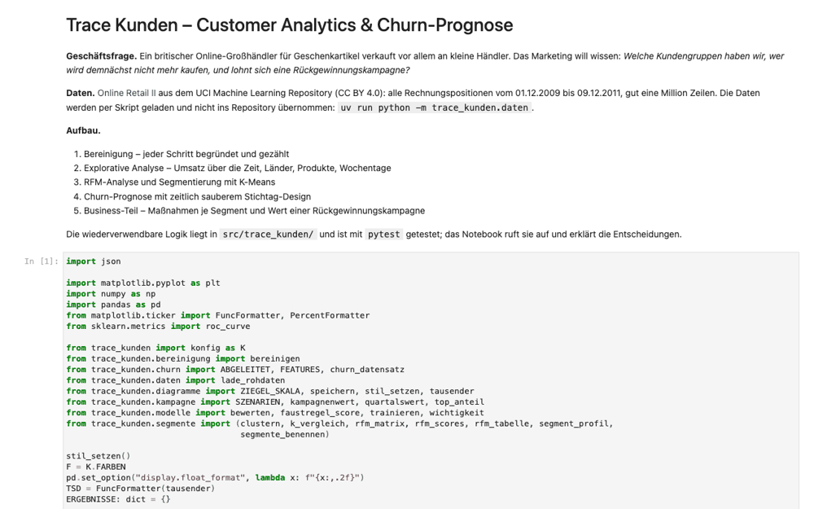

## Problem & Motivation

Ein britischer Online-Großhändler für Geschenkartikel verkauft vor allem an kleine Händler. Das Marketing hat drei
Fragen:

1. **Welche Kundengruppen haben wir?** Wer bringt den Umsatz, wer ist kurz davor, abzuspringen?
2. **Wer wird in den nächsten 90 Tagen nicht mehr kaufen?** Und wie viel besser ist ein Modell als die Faustregel
   „lange nichts gekauft“?
3. **Lohnt sich eine Rückgewinnungskampagne,** und wen sollte man anschreiben?

Die Fragen sind typisch für jedes Unternehmen mit wiederkehrenden Kunden, auch im technischen Mittelstand (Wartungs-
verträge, Ersatzteilkunden). Der Datensatz ist öffentlich und real, deshalb lassen sich alle Zahlen nachrechnen.

## Lösung & Architektur

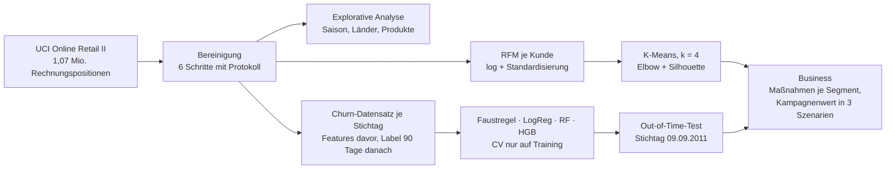

| Teil | Wo | Was passiert |
|---|---|---|
| Daten laden | `src/trace_kunden/daten.py` | Lädt das ZIP von UCI, liest beide Excel-Blätter und speichert sie als Parquet (7 MB) |
| Bereinigung | `bereinigung.py` | Jeder Schritt zählt entfernte Zeilen und nennt den Grund (Protokoll) |
| Segmente | `segmente.py` | RFM, Quintil-Scores, K-Means mit festem Seed, regelbasierte Segmentnamen |
| Churn | `churn.py` | Population, Merkmale und Label zu einem Stichtag. Merkmale sehen nur Daten vor dem Stichtag. |
| Modelle | `modelle.py` | Drei Modelle mit Klassengewichten, Hyperparameter per 5-facher CV, Metriken, Permutation Importance |
| Kampagne | `kampagne.py` | Wertrechnung mit offen genannten Annahmen in drei Szenarien |
| Diagramme | `diagramme.py` | Einheitlicher Stil in Tracewell-Farben, Palette mit Farbfehlsichtigkeits-Prüfung validiert |
| Analyse | `notebooks/kundenanalyse.ipynb` | Ruft die Module auf und begründet jede Entscheidung in Markdown |

### Das Stichtag-Design (gegen Data Leakage)

Würde man RFM über alle Daten rechnen und Churn als „90 Tage nichts gekauft“ definieren, stünde das Label schon in
den Merkmalen, und das Modell sähe täuschend gut aus. Deshalb sehen die Merkmale nur Käufe *vor* einem Stichtag,
und das Label zählt erst die 90 Tage *danach*. Trainiert wird am 10.06.2011, getestet an einem späteren Stichtag
(09.09.2011), genau wie im Betrieb. Details zu Population, Leakage-Test, Robustheit und Merkmalsauswahl stehen in
[`docs/METHODIK.md`](docs/METHODIK.md).

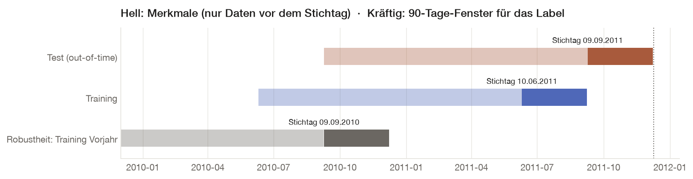

## Tech-Stack

| Bereich | Technik |
|---|---|
| Analyse | Python 3.12, pandas 3.1, NumPy, scikit-learn 1.9 |
| Visualisierung | matplotlib, eigener Stil in Tracewell-Farben |
| Notebook | JupyterLab, nbconvert (reproduzierbare Ausführung), jupytext |
| Qualität | pytest (17 Tests mit handgebauten Mini-Datensätzen), ruff |
| Umgebung | uv, ein Startbefehl (`./start.sh`) |

Kein LLM, kein Server, keine Cloud: Das Projekt ist bewusst klassische Data Science.

**Tracewell** ist mein Startup. Aus dessen Designsystem stammen die Farben aller Diagramme (definiert in
`src/trace_kunden/konfig.py`, angewendet in `diagramme.py`); mit der Analyse selbst hat der Name nichts zu tun.

## Daten

[Online Retail II](https://archive.ics.uci.edu/dataset/502/online+retail+ii), UCI Machine Learning Repository
(Daqing Chen, Lizenz CC BY 4.0). Alle Rechnungspositionen eines britischen Online-Händlers vom 01.12.2009 bis
09.12.2011. Die Daten werden per Skript geladen und **nicht** ins Repository übernommen (`data/` steht in
`.gitignore`).

Lizenz: Code [MIT](LICENSE) · Daten: UCI Online Retail II, CC BY 4.0 (nicht im Repo, per Skript geladen)

## Ergebnisse & Evaluation

Reproduzierbar mit `./start.sh --neu` (ca. 2 Minuten nach dem einmaligen Download). Alle Kennzahlen stehen
zusätzlich maschinenlesbar in `eval/ergebnisse.json`.

### 1. Bereinigung

| Schritt | Entfernte Zeilen | Begründung |
|---|---:|---|
| Exakte Duplikate | 34.335 | u. a. Überlappung der beiden Excel-Blätter, würden Umsatz doppelt zählen |
| Fehlende Kunden-ID | 235.151 | Kauf keinem Kunden zuzuordnen. **Achtung:** 15 % des Umsatzes |
| Stornos ausgegliedert | 18.390 | kein Umsatz, aber aufbewahrt als Merkmal „Storno-Quote“ |
| Stornierte Käufe (Ausreißer) | 6.332 | Käufe mit passender Gegenbuchung, darunter die Extremwerte 80.995 und 74.215 Stück |
| Keine Produkte | 2.706 | Porto, Gebühren, manuelle Buchungen, Testartikel |
| Menge oder Preis ≤ 0 | 59 | Korrektur- oder Gratisbuchungen |
| **Ergebnis** | **770.398 Zeilen** | **5.839 Kunden, £16,5 Mio. Umsatz** |

Großkunden (6 % der Kunden über Q3 + 3·IQR, zusammen 55 % des Umsatzes) bleiben drin. Sie sind keine Fehler, sondern
die wichtigsten Kunden; ihren Einfluss auf K-Means dämpft die Log-Transformation.

### 2. Explorative Analyse

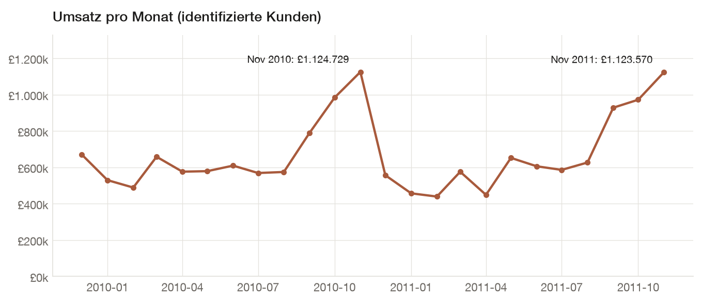

- **Saisonalität bestimmt alles:** September bis November bringen 37 % des Jahresumsatzes, Spitze jeweils im
  November mit gut £1,1 Mio. Die Kunden sind Händler, die sich für Weihnachten eindecken.
- **84 % des Umsatzes aus UK,** im Ausland vor allem Irland, Niederlande, Deutschland, Frankreich.
- **Breites Sortiment ohne Bestseller:** Der stärkste von 4.611 Artikeln bringt 1,6 % des Umsatzes.
- **B2B-Rhythmus:** Bestellt wird werktags und sonntags zwischen 10 und 15 Uhr, samstags gar nicht.

### 3. Segmente (RFM + K-Means)

k = 4: höchste Silhouette (0,36) ab k = 3 und Knick im Elbow-Diagramm. k = 2 hätte die höchste Silhouette (0,44),
trennt aber nur „aktiv/inaktiv“, daraus folgt keine Maßnahme.

| Segment | Kunden | Anteil Umsatz | Recency (Median) | Bestellungen (Median) | Umsatz (Median) |
|---|---:|---:|---:|---:|---:|
| **Top-Kunden** | 1.168 (20 %) | **73 %** | 16 Tage | 13 | £4.905 |
| **Gefährdete Stammkunden** | 1.469 (25 %) | 17 % | 178 Tage | 4 | £1.447 |
| **Neue & Gelegenheitskunden** | 1.231 (21 %) | 6 % | 23 Tage | 3 | £715 |
| **Verlorene Einmalkäufer** | 1.971 (34 %) | 4 % | 400 Tage | 1 | £269 |

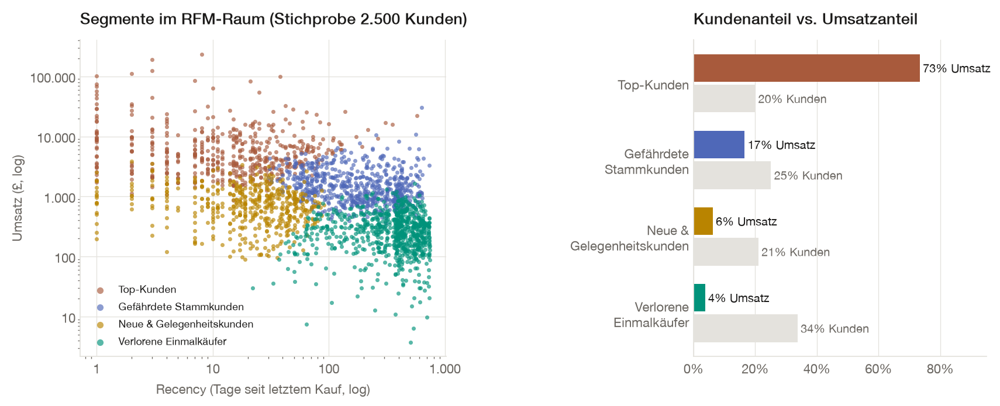

### 4. Churn-Prognose (Out-of-Time-Test am 09.09.2011)

4.316 Kunden im Training (Churn-Rate 64,2 %, Sommerfenster), 4.305 im Test (49,5 %, Herbstfenster vor
Weihnachten). Klassenungleichgewicht über Klassengewichte; Hyperparameter per 5-facher CV nur auf dem Training.

| Modell | CV ROC-AUC (Training) | **ROC-AUC (Test)** | PR-AUC | Precision | Recall | F1 | Trefferquote Top 20 % |
|---|---:|---:|---:|---:|---:|---:|---:|
| Faustregel: Tage seit letztem Kauf | – | 0,706 | 0,659 | 0,693 | 0,493 | 0,576 | 70,6 % |
| **Logistic Regression** | 0,806 | **0,766** | **0,728** | 0,661 | 0,791 | 0,720 | 76,4 % |
| Random Forest | 0,809 | **0,766** | 0,726 | 0,658 | 0,814 | 0,728 | **76,5 %** |
| HistGradientBoosting | 0,808 | 0,765 | 0,715 | 0,662 | 0,814 | **0,730** | 75,6 % |

Precision, Recall und F1 bei Schwelle 0,5. Zufällige Auswahl träfe 49,5 %.

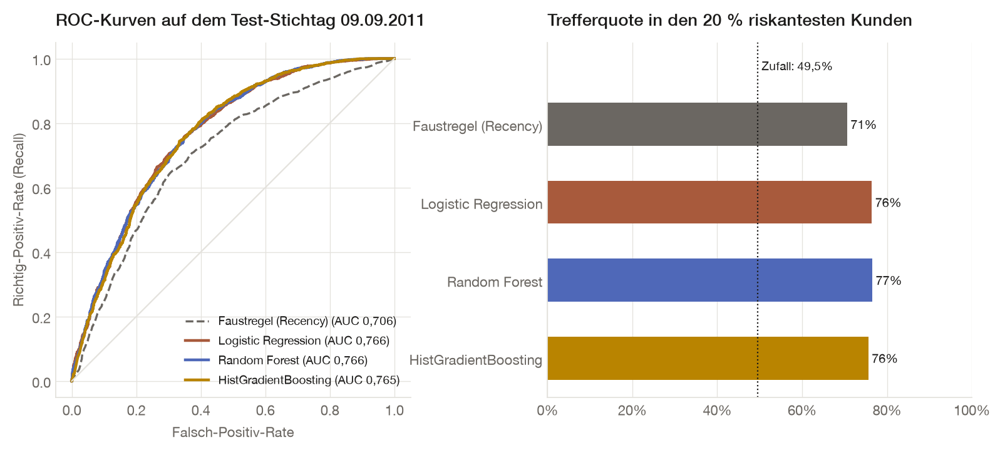

Robustheit (Training ein Jahr früher) und die Iteration der Merkmale von 14 auf 11 stehen in
[`docs/METHODIK.md`](docs/METHODIK.md).

| Wichtigste Merkmale (Permutation Importance, LogReg) | Rückgang ROC-AUC | Richtung |
|---|---:|---|
| Käufe in den letzten 90 Tagen | 0,046 | mehr Käufe → weniger Risiko |
| Umsatz gesamt | 0,032 | mehr Umsatz → weniger Risiko |
| Anzahl Bestellungen | 0,020 | mehr → weniger Risiko |
| Aktive Monate in den letzten 12 | 0,017 | mehr → weniger Risiko |
| Kundendauer | 0,014 | bei gleicher Aktivität: länger → mehr Risiko |

### 5. Business: Was ist eine Rückgewinnungskampagne wert?

Rückblickend auf dem Test-Stichtag (wer wirklich abgewandert ist, ist bekannt). Wert eines zurückgewonnenen Kunden =
Ø Quartalsumsatz der letzten 12 Monate × Marge × Quartale.

| Annahme | pessimistisch | realistisch | optimistisch |
|---|---:|---:|---:|
| Erfolgsquote bei echten Abwanderern | 5 % | 10 % | 15 % |
| Kosten je Kontakt (Gutschein, Versand, Mitnahmeeffekt) | £8 | £5 | £3 |
| Marge auf zurückgewonnenen Umsatz | 20 % | 25 % | 30 % |
| Dauer des zurückgewonnenen Umsatzes | 1 Quartal | 1 Quartal | 2 Quartale |

**Ergebnis bei 20 % angeschriebenen Kunden (861):**

| Strategie | Trefferquote (echte Abwanderer) | Erreichter Quartalsumsatz | **Nötige Erfolgsquote (Break-even)** | pessimistisch | realistisch | optimistisch |
|---|---:|---:|---:|---:|---:|---:|
| Zufällig | 51 % | £74.433 | 23,1 % | −£6.144 | −£2.444 | £4.116 |
| Faustregel (Recency) | 71 % | £66.393 | 25,9 % | −£6.224 | −£2.645 | £3.392 |
| Modell (nur Risiko) | **76 %** | £39.438 | 43,7 % | −£6.494 | −£3.319 | £966 |
| **Modell × Kundenwert** | 41 % | **£177.025** | **9,7 %** | −£5.118 | **£121** | **£13.349** |

Optimum im realistischen Szenario: die **6 % Kunden mit dem höchsten erwarteten Verlust** (258 Kunden), Ergebnis
**£979 bei 76 % ROI**.

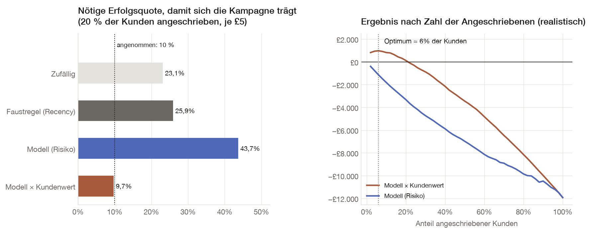

### Interpretation

- **Komplexere Modelle bringen hier nichts.** Alle drei Modelle liegen bei ROC-AUC 0,77. Der Zusammenhang ist
  weitgehend monoton („weniger aktiv → eher weg“). Ich empfehle die **Logistic Regression**: gleich gut, robuster
  beim Vorjahrestest und erklärbar.
- **Das Modell schlägt die Faustregel deutlich, aber nicht dramatisch:** ROC-AUC 0,71 → 0,77, Trefferquote in den
  riskantesten 20 % 71 % → 76 %. Das ist erwartbar für Transaktionsdaten ohne weitere Signale (Website-Besuche,
  Reklamationen, Außendienstkontakte).
- **Out-of-Time ist strenger als Kreuzvalidierung:** 0,81 in der CV, 0,77 am späteren Stichtag. Ein zufälliger Split
  hätte diese Lücke versteckt. Ursache ist die Saison: Im Training wanderten 64 % ab, im Test 50 %. Deshalb arbeitet
  die Kampagne mit der Rangfolge statt mit einer festen Schwelle.
- **Der wichtigste Business-Befund:** Die riskantesten Kunden sind meist die kleinsten. Eine Kampagne nach reinem
  Churn-Risiko ist deshalb die *schlechteste* Strategie, obwohl sie die meisten Abwanderer trifft. Die
  Gewichtung mit dem Kundenwert bringt die Kampagne knapp über die Gewinnschwelle (realistisch +£121 bei 861
  Kunden, Optimum £979 bei 258 Kunden). Der Kern bleibt: Breite Aktionen lohnen sich nicht. Unter
  vorsichtigen Annahmen bleibt nur eine **kleine, gezielte Aktion** für einige hundert wertvolle, gefährdete
  Kunden, dafür aber auch mit teureren Kanälen (Anruf statt Gutschein-Mail).
- **Timing:** Die Kunden kaufen saisonal. Eine Rückgewinnung wirkt Anfang September vor dem Weihnachtsgeschäft,
  nicht im Juli.

## Screenshots

| Notebook | Bestellungen nach Wochentag und Uhrzeit |
|---|---|
| 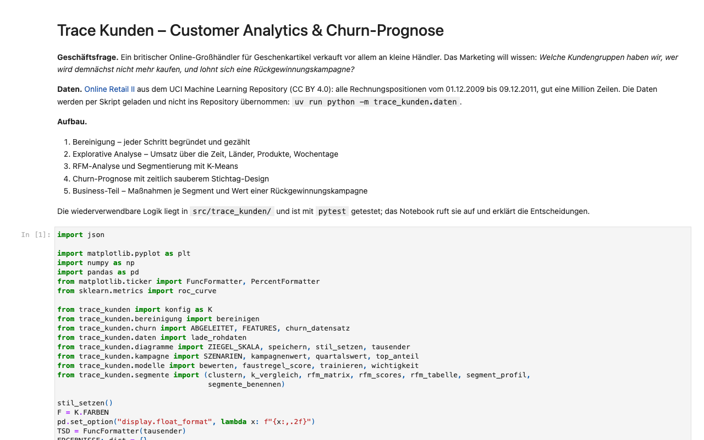 | 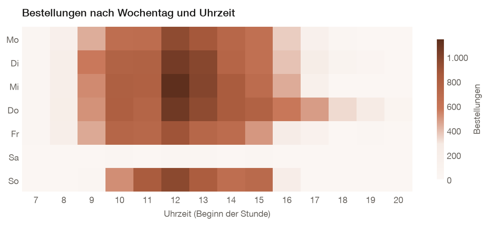 |
| **Wahl von k** | **Permutation Importance** |
| 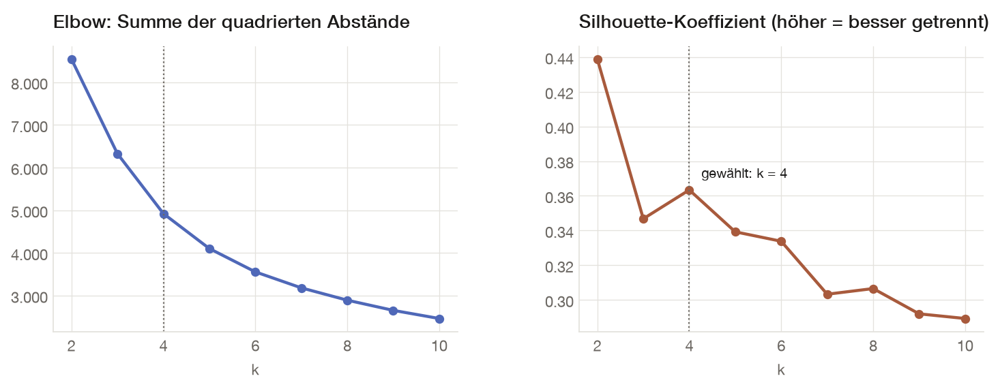 | 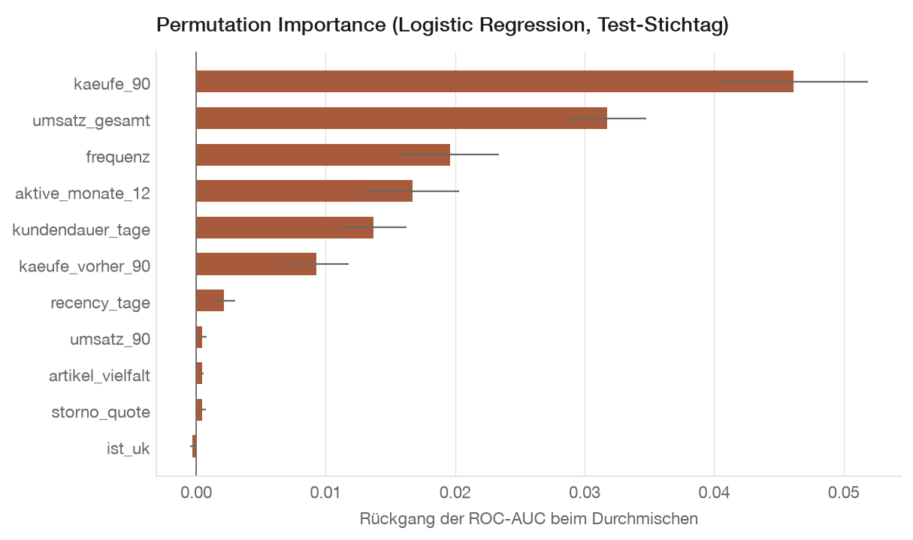 |

Weitere Diagramme in [`docs/`](docs/), das vollständige Notebook mit allen Ausgaben in
[`notebooks/kundenanalyse.ipynb`](notebooks/kundenanalyse.ipynb).

## Starten

Voraussetzung: [uv](https://docs.astral.sh/uv/). Kein LLM und kein Node nötig. Getestet auf macOS (bash).

```bash
./start.sh
```

Beim ersten Start lädt das Skript die Daten von UCI (45 MB, Einlesen 2–3 Minuten, kurzzeitig ~600 MB RAM) und
öffnet dann das Notebook in JupyterLab.

```bash
./start.sh --neu
```

Führt das Notebook ohne Oberfläche komplett neu aus und aktualisiert Diagramme und `eval/ergebnisse.json`.

```bash
uv run pytest
```

## Grenzen & nächste Schritte

**Grenzen**
- **15 % des Umsatzes fehlen** (Käufe ohne Kunden-ID). Wenn das systematisch bestimmte Kunden sind (z. B.
  Gastbestellungen), sind die Segmente verzerrt.
- **Churn ist eine Definition, keine Beobachtung.** Händler kaufen saisonal; wer 90 Tage nichts kauft, ist
  vielleicht nur in der Sommerpause. Ein Fenster von 180 Tagen oder ein saisonbereinigtes Label wären Alternativen.
- **Kalibrierung:** Die Wahrscheinlichkeiten sind wegen der Saison zu hoch (das Modell erwartet 64 % Abwanderung,
  es sind 50 %). Für Rangfolgen egal, für absolute Prognosen nicht.
- **Die Kampagnenrechnung ist eine Abschätzung.** Erfolgsquote, Kosten und Marge sind Annahmen. Sie misst außerdem
  nicht, wer *wegen* der Kampagne bleibt. Dafür braucht es einen A/B-Test mit Kontrollgruppe.
- **Zwei Jahre Daten, ein Händler, 2009–2011.** Die Zahlen sind ein Fallbeispiel, kein Branchen-Benchmark.
- **Segmente überlappen** (Silhouette 0,36). Kunden liegen auf einem Kontinuum, die vier Gruppen sind eine
  nützliche Vereinfachung.

**Nächste Schritte**
1. A/B-Test der Kampagne mit Kontrollgruppe, danach **Uplift-Modellierung** (wer reagiert auf die Kampagne, nicht
   nur: wer geht).
2. Mehrere Trainings-Stichtage stapeln (z. B. monatlich), damit das Modell alle Saisonphasen sieht; Kalibrierung
   der Wahrscheinlichkeiten.
3. **Customer Lifetime Value** statt Quartalswert (z. B. BG/NBD + Gamma-Gamma), um den Kundenwert besser zu
   schätzen.
4. Schlankeres Modell mit 5 Merkmalen prüfen und als monatlichen Report für das Marketing betreiben.

## Was ich gelernt habe

Am meisten überrascht hat mich, dass das einfachste Modell gewonnen hat. Ich hatte erwartet, dass Random Forest oder Gradient Boosting klar vorne liegen. Am Ende war die Logistic Regression genauso gut, und sie lässt sich jedem Marketing-Team in zwei Sätzen erklären. Deshalb empfehle ich sie. Am längsten gebraucht habe ich, um das Stichtag-Design wirklich zu verstehen: Das Modell darf nur sehen, was vor dem Stichtag passiert ist. Sonst schaut es quasi in die Zukunft, die Zahlen sehen toll aus, und in der Praxis funktioniert es nicht.

Der wichtigste Teil war für mich aber nicht das Modell, sondern die Kampagnenrechnung. Sie hat gezeigt, dass eine breite Rabattaktion eher Geld verbrennt und nur eine kleine, gezielte Aktion mit Testgruppe Sinn ergibt. Genau an dieser Stelle hat mir mein Marketing-Studium geholfen: Ein gutes Modell ist nur so viel wert wie die Entscheidung, die man daraus ableitet.

**Zur Arbeit mit Claude Code:** Programmiert habe ich mit Claude Code als Pair-Programmer. Das ging schnell, aber die Entscheidungen musste ich selbst treffen: Was ist die richtige Frage, was ist ein fairer Vergleich, welche Zahl kann ich guten Gewissens nennen? Eine kritische Prüfung am Ende hat mehrere Aussagen gefunden, die zu optimistisch formuliert waren. Mein wichtigstes Learning: KI beschleunigt die Arbeit, aber prüfen und verantworten muss ich selbst.

---

Entwickelt von Endrit Demhasaj mit [Claude Code](https://claude.com/claude-code) als Pair-Programmer. Fragestellung,
Bewertung der Ergebnisse und fachliche Annahmen habe ich verantwortet. Daten: UCI Machine Learning Repository
(CC BY 4.0). Designsystem: [Tracewell](https://tracewell.de).
