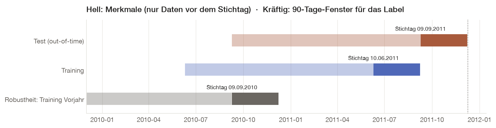

# Methodik im Detail

Ergänzung zur [README](../README.md). Alle Zahlen stammen aus [`eval/ergebnisse.json`](../eval/ergebnisse.json)
und dem Notebook [`notebooks/kundenanalyse.ipynb`](../notebooks/kundenanalyse.ipynb).

## Das Stichtag-Design (gegen Data Leakage)

Die naheliegende Variante „RFM über alle Daten, Churn = 90 Tage nichts gekauft“ würde nahezu perfekt aussehen,
weil das Label schon in der Recency steckt. Das Modell würde „vorhersagen“, was bereits passiert ist.

Stattdessen wird die Situation im Einsatz nachgestellt:
- **Merkmale** nur aus Käufen *vor* dem Stichtag. Ein Test manipuliert alle Daten ab dem Stichtag und prüft, dass
  sich die Merkmale nicht ändern.
- **Label:** Churn = 1, wenn in den **90 Tagen nach** dem Stichtag kein Kauf kommt.
- **Population:** nur Kunden mit Kauf in den 12 Monaten vor dem Stichtag. Längst verlorene Kunden würden die
  Kennzahlen künstlich verbessern.
- **Out-of-Time-Test:** Training am 10.06.2011, Test am 09.09.2011. Das Label-Fenster des Trainings endet vor dem
  Test-Stichtag, genau wie im Betrieb.

## Robustheit

Training im gleichen Saisonfenster ein Jahr früher (Stichtag 09.09.2010, 3.332 Kunden, Churn-Rate 42,2 %),
getestet am 09.09.2011:

| Modell | ROC-AUC (Test) |
|---|---:|
| Logistic Regression | 0,768 |
| Random Forest | 0,747 |
| HistGradientBoosting | 0,745 |

Die Logistic Regression bleibt stabil, die Baum-Modelle verlieren etwas. Das ist ein Grund für die Empfehlung der
Logistic Regression in der README.

## Iteration der Merkmale

Die erste Version hatte 14 Merkmale, darunter drei Verhältnisse (Ø Warenkorb, Ø Abstand zwischen Käufen,
„überfällig“). Gleiche Güte (ROC-AUC 0,768), aber in der Logistic Regression unplausible Gewichte: Recency wirkte
negativ, weil log(Warenkorb) = log(Umsatz) − log(Frequenz) eine exakte Linearkombination ist (Multikollinearität).
Mit 11 Merkmalen bleibt die Güte (0,766), und die Gewichte lassen sich wieder lesen.
